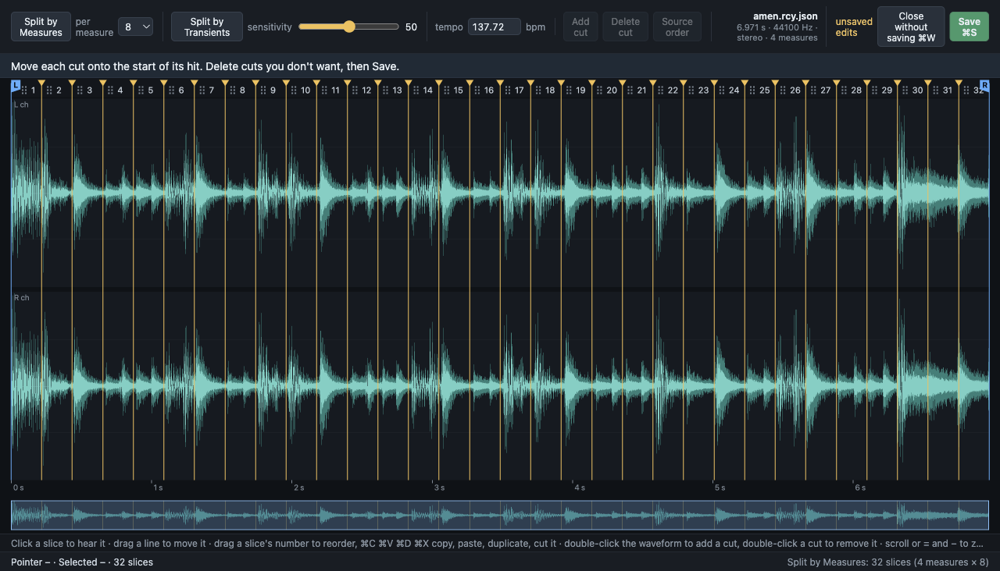
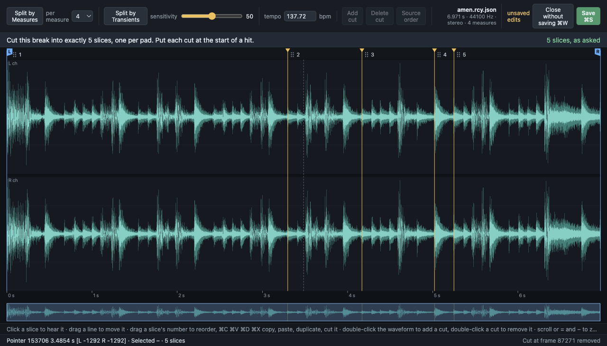
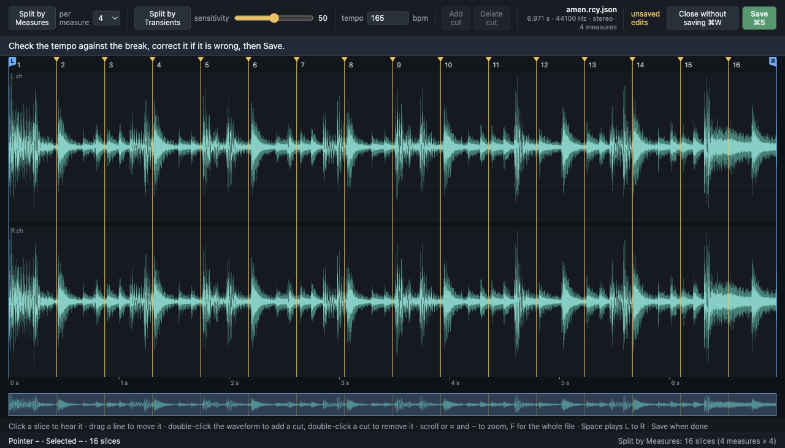
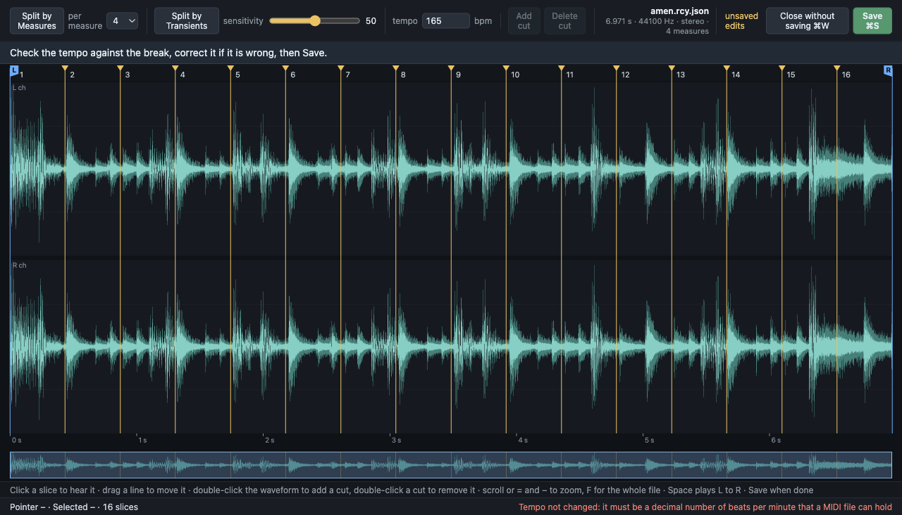

# rcy

rcy turns a recorded drum break into a sampler kit: one audio file per drum
hit, with the instrument and MIDI files a sampler needs to play them. An
agent prepares the cut and a person corrects it in a window. This page
explains why the work is divided that way, what the division implies about
agents and people working together, and how one break goes through it.

## Why a person still looks at the waveform

Finding where drum hits begin is an old problem with good solutions. The
`onset_detect` function in librosa returns a list of onset times for a break
in well under a second, and the window's own Split by Transients does the
same job. Cutting a break is a different question from detecting its
onsets, in two ways.

The first is which onsets become cuts. Four bars of a funk break hold a ride
cymbal stroke on most eighth notes, kicks and snares on some of them, and
quieter ghost notes between. A detector reports as many of these as its
threshold admits. A kit, though, has a fixed number of pads, and each pad has
to be worth playing by itself. Whether a ghost note belongs to the snare
after it or gets its own pad depends on what the kit is for, and the answer
changes with the track being made. The audio doesn't contain it.

The second is where exactly a cut goes. A detector marks the frame where
energy rises past a threshold. The useful cut is usually a little earlier,
at the start of the attack, and it has to avoid the previous hit's tail,
because a slice that begins in the middle of a loud waveform clicks when a
sampler triggers it. On a break recorded live to tape there is no silence
between hits to cut in; the cymbal rings through everything. Every cut lands
in sounding audio, and the person choosing it is trading a clipped attack
against a click against a few milliseconds of the previous drum. People who
do this listen to each slice alone and move the cut until it sounds right.
We don't know how to write that judgment down as a function.

So the detector's output is a first draft. It is a good one, and it saves
most of the work. The remaining part needs someone to hear the result, and
hearing takes a person, a waveform they can zoom to single samples, and a
way to play one slice.

## What this implies for agents

An agent can do everything in this job except the listening: find the file,
work out the tempo, run the detector, choose a grid, cut the audio, write
the sampler formats, upload the kit to hardware. The design question is how
to put the person's judgment into that sequence without making the person
operate the software.

rcy's answer is that the window is a function the agent calls. The agent
states the whole task on the command line: which manifest, which first-draft
split, the sentence the person reads at the top of the window, where the
result goes, and optionally the tempo and the number of slices the result
must have. The window opens already in that state. It has no file picker, no
save dialog and no settings screen, because the agent has answered
everything those would ask. The person does the one thing that was left for
them and presses Save, and the agent gets back an exit code and an edited
manifest.

Two properties of that arrangement matter beyond drum breaks.

The person's time goes only to judgment. They never choose a file or name an
output, so a correction that takes thirty seconds of listening takes thirty
seconds in total.

Every run also leaves a record of the disagreement between the two parties.
The file named by `--record` holds the cuts the agent proposed, the cuts the
person kept, and every edit, undo and audition between them with its time in
milliseconds. A pile of those records is a dataset about taste: where one
person, on real material, moved a machine's proposal and by how much. That
is what the records are for, and it's the reason the window writes one even
when the person closes without saving. No program in this repository reads
them. The detector doesn't improve from them and nothing is trained; an
agent or a person can read the pile and see, for instance, that the
proposals on a given break are consistently early. The records name local
paths, so `runs/` is ignored by git.

## One break: four bars of the Amen

The file `presets/amen.wav` is the drum break from "Amen, Brother" by The
Winstons (1969), played by Gregory Coleman. It runs 6.971 seconds, which rcy
takes as four bars of 4/4 and therefore 137.72 beats per minute.

```
workflows/new-kit presets/amen.wav 4 work/amen
```

That command gives the person an eighth-note grid as the first draft, 32
equal slices of 217.8 ms each:



At this zoom the grid looks right. It isn't, and the size of the error is
measurable, because the detector can be run on the same file:


At its default sensitivity the detector finds seven onsets. Each of them
falls after the nearest grid line, by these amounts:

| Detected onset | Nearest grid cut | Onset is later by |
|---|---|---|
| 0.445 s | 2 | 9.0 ms |
| 1.101 s | 5 | 11.5 ms |
| 1.979 s | 9 | 18.4 ms |
| 3.299 s | 15 | 31.1 ms |
| 4.170 s | 19 | 31.5 ms |
| 5.021 s | 23 | 10.8 ms |
| 5.249 s | 24 | 21.2 ms |

Cuts are numbered as the window's status line numbers them. The grid assumes
32 eighth notes of equal length in a file that is exactly four bars long,
and the offsets, largest in the middle of the break, say that at least one
of those assumptions is wrong for this recording. The table can't separate
a drummer's timing from an imprecise bar count or from the detector's own
placement, and it doesn't need to: a grid cut that is 31 ms early puts 31 ms
of the previous hit at the front of the slice, whatever the cause.

Zoomed in on grid cut 5, the gap is visible. The hit the cut belongs to
starts at about 1.10 s, to the right of the cut, and everything between
them is the tail of the hit before. (The script that takes these pictures
has dragged the cut a further 30 pixels left, only to show a drag in
progress.)


The detector is not simply the better draft, though. It returned seven
onsets from four bars that hold several times that many drum strokes, so a
kit cut from it has eight long slices, most of them containing more than one
hit. Raising the sensitivity returns more onsets, and at no setting does the
detector know which of them the kit should keep. The grid has the opposite
fault: a cut for every eighth note, each a few milliseconds off. The person
starts from whichever draft is closer to the kit they want and fixes the
rest by ear.

When the kit must have an exact number of pads, the agent says so, and the
window enforces it:

```
workflows/pick-hits presets/amen.wav 4 5 work/five
```

Save stays unavailable while the count is wrong, as in the picture above,
and becomes available when it matches:



The pictures on this page come from a script that drives the window, so the
five slices shown are whichever were left after it removed the first three
cuts, not a musician's choice. Which five hits of the Amen deserve pads is
exactly the decision the window exists to hand to a person.

Tempo gets the same treatment as cuts. The 137.72 is arithmetic on the
file's length and a bar count somebody supplied; if either is off, so is the
tempo in the kit's MIDI file. The agent can state a tempo at launch with
`--bpm` (or `RCY_BPM` in front of a workflow), and the person can change it
in the toolbar. Only the recorded tempo changes. The audio is never
time-stretched.



A tempo that a MIDI file can't hold is refused where it was typed, and the
field returns to the last accepted number:



A task can also point the person at a single cut with `--view` and
`--select`, for the case where an agent, or a person listening to the kit,
has found one slice that starts wrong:


After Save, the workflow cuts the kit from the saved manifest and leaves
this:

```
work/amen/
  source/            the break as one slice per measure, and its manifest
  edited.rcy.json    the manifest the person saved
  run.json           the run record
  amen/              the kit: WAV slices, .sfz, .exs, .mid, .rcy.json
```

Each slice file keeps 20 ms of source audio either side of its cut, with the
cut written into the instrument files as the start point. A cut that turns
out a few milliseconds late can then be corrected in the sampler without
going back to the window.

## Reference

This is an alpha; the file formats and command lines can still change.
`rcy-export` writes kits and never asks anything. `rcy-window` is the
window. `SPEC.md` and `WINDOW.md` state their complete behaviour.

### The contract of a window run

| | |
|---|---|
| In | A manifest, the opening split, the task text, and optionally a tempo and the slice count the result must have. All of it is on the command line. |
| Out | An exit code, the edited manifest at `--out`, and a run record at `--record`. |

| Exit code | Meaning | What the caller does |
|---|---|---|
| 0 | The person saved. | Cut the kit from the manifest at `--out`. |
| 3 | The person closed without saving. | Nothing was written to `--out`; stop or ask again. |
| 2 | The launch was refused; the reason is on stderr. | Fix the command line. |

A refusal costs the person nothing, because the window never opens. Here
and below, `electron` is the binary at
`tools/window-runtime/node_modules/electron/dist/Electron.app/Contents/MacOS/Electron`:

```
$ electron window/rcy-window --manifest kit.rcy.json --record run.json --bpm fast
rcy-window: --bpm must be a decimal number of beats per minute
$ echo $?
2
```

### Workflows

Each script in `workflows/` is one whole task in a few lines of `sh`: it
prepares the manifest, opens the window, waits, and exits with the window's
code. Each takes a task directory that doesn't exist yet.

| Command | First draft the person sees |
|---|---|
| `workflows/new-kit SOURCE.wav MEASURES TASK_DIR` | A grid, eighth notes by default. |
| `workflows/pick-hits SOURCE.wav MEASURES COUNT TASK_DIR` | Detected transients; Save needs exactly `COUNT` slices. |
| `workflows/recut KIT.rcy.json TASK_DIR` | The kit's own cuts, unchanged. |

### Settings

The workflows read these from the environment.

| Variable | Default | Meaning |
|---|---|---|
| `RCY_BUFFER_MS` | 20 | Milliseconds of source audio kept either side of each slice. |
| `RCY_SPLIT_RESOLUTION` | 8 | `new-kit`: slices per measure in the opening split. |
| `RCY_SENSITIVITY` | 50 | `pick-hits`: transient sensitivity of the opening split, 0 to 99. |
| `RCY_BPM` | unset: the tempo worked out from the break's length and measure count | The kit's tempo in beats per minute when the window opens. The person can change it with the window's `bpm` control. |
| `RCY_ELECTRON` | the binary under `tools/window-runtime` | The Electron binary that runs the window. |

### Calling the window directly

```
electron window/rcy-window --manifest KIT.rcy.json --out EDITED.rcy.json --record RUN.json \
    [--split measures --resolution R | --split transients --sensitivity S] \
    [--bpm B] [--view START:END] [--select I] [--task TEXT] [--expect-slices K]
```

### The run record

```json
{
  "rcy_window_run": 1,
  "arguments": ["--manifest", ".../source.rcy.json", "--split", "transients", "--expect-slices", "5", "..."],
  "started_at": "...", "ended_at": "...", "duration_ms": 1785,
  "exit_code": 0,
  "outcome": "saved",
  "opening": { "bpm": 137.71790859793566, "boundaries": [0, 19608, 48539, 87271, 145469, 183914, 221429, 231492, 307411] },
  "events": [
    { "t_ms": 662, "kind": "edit", "what": "Cut at frame 19608 removed", "boundaries": ["..."], "slices": 7, "bpm": 137.71790859793566 },
    { "t_ms": 1210, "kind": "play", "from": 0, "to": 9606 }
  ],
  "final": { "bpm": 137.71790859793566, "boundaries": [0, 145469, 183914, 221429, 231492, 307411] }
}
```

The example is shortened. Positions are in frames at 44.1 kHz.

### Kits

`rcy-export` writes one directory:

| File | Contents |
|---|---|
| `001.wav`, `002.wav`, ... | One WAV per slice, copied from the source without resampling, fades or gain change. |
| `<name>.sfz` | An SFZ instrument, one region per slice from MIDI key 60 upward. |
| `<name>.exs` | With `--exs`, a Logic Pro Sampler instrument. |
| `<name>.mid` | A MIDI file that plays the slices in order at the kit's tempo. |
| `<name>.rcy.json` | The manifest: source, tempo, cut positions in frames, and each slice's key and file. |

```
node export/rcy-export --input break.wav --measures 2 --resolution 8 --out /tmp/kit
node export/rcy-export --from-manifest /tmp/kit/kit.rcy.json --out /tmp/kit2 --exs --buffer-ms 20
RCY_PRESETS=presets node export/rcy-export --preset amen_classic --out /tmp/amen
```

The manifest is the editable form of a kit: the window reads and writes it,
and `--from-manifest` cuts the kit again from it. Sources are 16-bit WAV at
44.1 kHz, mono or stereo.

`--buffer-ms N` keeps N milliseconds of source audio either side of each
slice in its file and writes the slice's start and end points into the SFZ
and EXS instruments. A cut placed a few milliseconds into a hit then loses
nothing, and the points stay adjustable in the sampler. Without the option a
file holds exactly its slice.

`SPEC.md` states every option, file format rule and refusal message.

### Install

```
git clone https://github.com/abrilstudios/rcy && cd rcy
npm ci --prefix tools/window-runtime
```

`rcy-export` needs only Node.js; versions 24 and 26 are the ones it has run
on. The second command installs Electron 33 for the window, which is built
and tested on macOS.

## How the programs are built

Each program has a specification that states its whole behaviour in numbered
requirements: `SPEC.md` for `rcy-export` and `WINDOW.md` for the window. A
coding agent changes the program against that text, and scenarios that drive
the real program check the result. The division of work is the one described
above for cuts. The scenarios settle everything that can be stated as a
check, and a person using the window reports what can't, such as a toolbar
that is hard to read.

A change goes like this. Edit `export/main.js`, `window/main.js` or
`rcy-sdk/src`, change `SPEC.md` or `WINDOW.md` to match in the same commit,
then rebuild:

```
node rcy-sdk/bin/build.cjs
node rcy-sdk/dist/bundle.cjs export/main.js export/rcy-export
node rcy-sdk/dist/bundle.cjs window/main.js window/rcy-window
```

`export/rcy-export` and `window/rcy-window` are build outputs, each the SDK
followed by its source in one file, and nobody edits them by hand. Both
specifications pin the SDK build and its README by SHA-256, and
`python3 bin/check-sdk` reports a mismatch, so a change to the SDK also
updates those two hashes in each specification.

`bin/generate` goes further and has an agent write a whole program from its
specification alone, inside a sandbox that denies it the scenarios.
`INVARIANTS.md` and `VALIDATION.md` hold the rules for that.

### Tests

```
cd rcy-sdk && node --test "test/*.test.ts"
```

```
NODE_PATH=tools/window-runtime/node_modules node features/window/scenarios.js \
    "$PWD/tools/window-runtime/node_modules/electron/dist/Electron.app/Contents/MacOS/Electron" \
    "$PWD/window/rcy-window" "$PWD/export/rcy-export" "$PWD/presets/amen.wav"
```

The window scenarios open real windows and drive them with the pointer and
keyboard. Keep the machine's own pointer still while they run, and don't
start them while someone is working on that screen.

The Gherkin scenarios for `rcy-export` run through `uv run bin/trial`. They
depend on `riemann-harness`, a private repository pinned in `pyproject.toml`,
and can't be installed without access to it.

### Screenshots

The pictures in this file come from the running window. After a change to
how it looks, retake them:

```
NODE_PATH=tools/window-runtime/node_modules node docs/screenshots/capture.js \
    "$PWD/tools/window-runtime/node_modules/electron/dist/Electron.app/Contents/MacOS/Electron"
```

## Layout

| Path | Contents |
|---|---|
| `workflows/` | The scripted tasks above. |
| `SPEC.md`, `WINDOW.md` | The behaviour of the two programs, kept in step with the code. |
| `export/main.js`, `window/main.js` | The programs' sources. |
| `export/rcy-export`, `window/rcy-window` | The programs as run. |
| `rcy-sdk/` | The code for every file format (WAV, MIDI, SFZ, EXS, manifest), with its tests and `dist/bundle.cjs`, which builds a program file. |
| `presets/` | The preset catalog and its audio. |
| `features/` | Acceptance scenarios: Gherkin for `rcy-export`, a Playwright script for the window. |
| `docs/screenshots/` | The pictures in this file and `capture.js`, which takes them. |
| `harness/`, `bin/` | Step definitions and tooling for the Gherkin scenarios and for generating a program from its specification. |
| `INVARIANTS.md`, `VALIDATION.md`, `BASELINE.md`, `DEFERRED.md` | Rules and records for that generation process. |
| `research/` | Notes on the behaviour of the earlier Python application. |
| `hardware/` | MIDI tools for the Akai S2800, the MPC2000XL and the EP-133. See `hardware/README.md`. |
