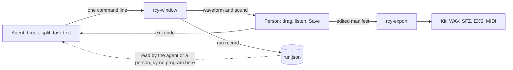
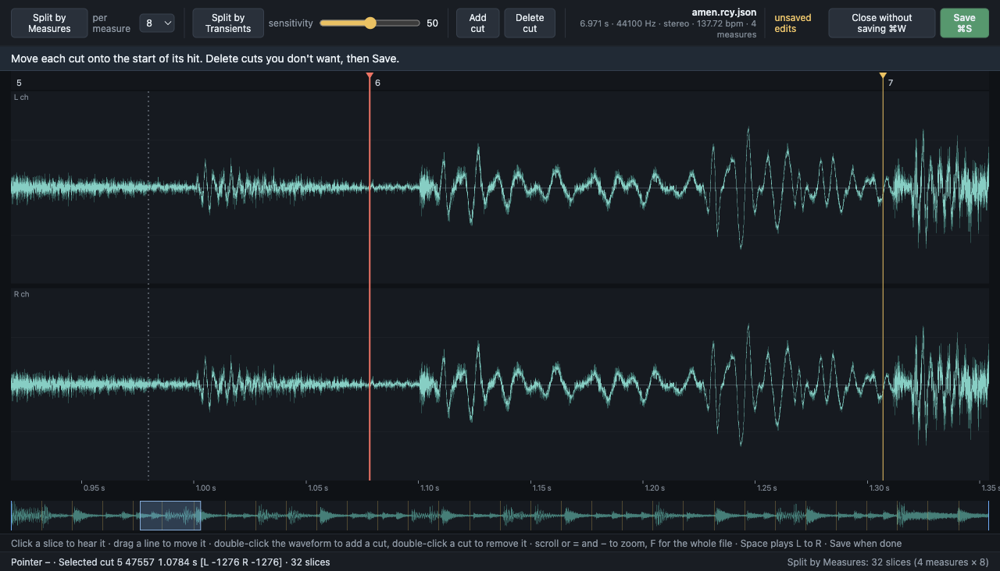
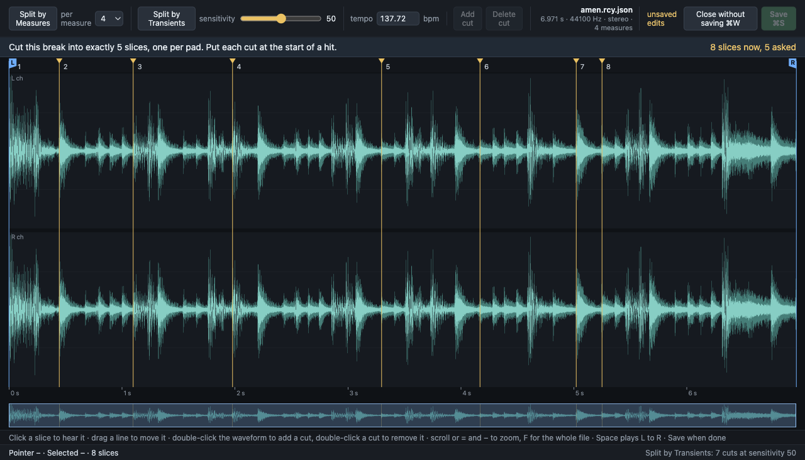
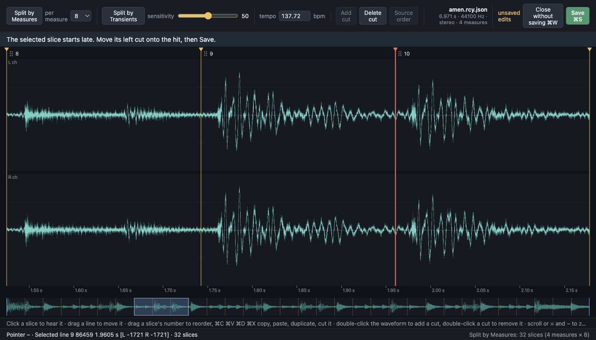

# rcy

rcy cuts a drum break into a sampler kit. An agent runs it: the agent picks
the break, guesses where the cuts go, and writes the whole task onto one
command line. Then a window opens in front of a person, because nobody has
yet taught a command line to hear a snare.


The person drags the cuts onto the hits and presses Save. The window closes,
the agent reads an exit code, and a kit lands on disk. No file picker, no
save-as dialog and no setup screen appear at any point, since every answer
they'd ask for is already in the arguments.

This is an alpha; the file formats and command lines can still change.

## RLHI

We call the loop RLHI, reinforcement learning with human input, and the name
is a joke with a straight face. Nothing in this repository trains a model.
What it does have is the bookkeeping an RL person would recognise, written
down on every run:

| RL word | What it is in rcy |
|---|---|
| Episode | One run of the window. |
| Action | The opening split the agent proposed: `opening` in the run record. |
| Environment | A person with headphones. |
| Feedback | The split the person kept (`final`), and every edit, undo and audition on the way there (`events`). |
| Reward | The exit code. 0 means they saved. 3 means they closed the window on you. |
| Policy update | The agent reading its own run records before it proposes again. No program here does that part for it. |



Two programs do the work. `rcy-export` writes kits and never asks anything;
`rcy-window` is the window.

## One episode

```
workflows/new-kit presets/amen.wav 4 work/amen
```

That's the source, its length in 4/4 measures, and a new task directory. The
script cuts the break into one slice per measure, opens the window on it with
an eighth-note split, and waits.

The person clicks a slice to hear it, drags a cut onto its hit, and
double-clicks to add or remove one. The wheel, or `=` and `-`, zooms as far
as single frames, which is where a cut gets placed on the start of a hit
rather than near it:



Save ends the run. The script cuts the kit from the saved manifest, keeping
20 ms of source audio either side of each slice, and leaves this behind:

```
work/amen/
  source/            the break as one slice per measure, and its manifest
  edited.rcy.json    the manifest the person saved
  run.json           the run record
  amen/              the kit: WAV slices, .sfz, .exs, .mid, .rcy.json
```

The script exits with the window's code, so the caller reads one number.

## The contract

A window run is a function call with a person inside it.

| | |
|---|---|
| In | A manifest, the opening split, the task text, and optionally a tempo and the slice count the result must have. All of it is on the command line. |
| Out | An exit code, the edited manifest at `--out`, and a run record at `--record`. |

| Exit code | Meaning | What the caller does |
|---|---|---|
| 0 | The person saved. | Cut the kit from the manifest at `--out`. |
| 3 | The person closed without saving. | Nothing was written to `--out`; stop or ask again. |
| 2 | The launch was refused; the reason is on stderr. | Fix the command line. |

A refusal costs the person nothing, because the window never opens. Here
and below, `electron` is the binary at
`tools/window-runtime/node_modules/electron/dist/Electron.app/Contents/MacOS/Electron`:

```
$ electron window/rcy-window --manifest kit.rcy.json --record run.json --bpm fast
rcy-window: --bpm must be a decimal number of beats per minute
$ echo $?
2
```

## Asking for exactly five

```
workflows/pick-hits presets/amen.wav 4 5 work/five
```

The third argument is the number of slices the result must have. An agent
filling a five-pad program wants five files, and "about five" is a bug it
would have to handle later. So the window opens with cuts at detected
transients and keeps Save unavailable while the count is wrong:



The person deletes cuts until the count matches, and Save becomes available:


The constraint lives in the window rather than in a retry loop, which means
the agent never receives a kit of four or six.

## Tempo

`rcy-export` works a tempo out from the break's length and its measure
count. When the agent knows better, it says so at launch with `--bpm`, or
with `RCY_BPM` in front of a workflow:

```
RCY_BPM=165 workflows/recut work/amen/amen/amen.rcy.json work/amen-165
```

The person can overrule it in the `bpm` field of the toolbar; typing a number
and pressing Enter is one undoable edit, like moving a cut.


A tempo the MIDI file can't hold is refused in place. The field goes back to
the last good number and the window says why; a Save pressed with the bad
number still in the field doesn't save:


The tempo goes into the manifest and the kit's MIDI file. The audio isn't
time-stretched, and auditioning a slice plays the source as recorded.

## Fixing a kit that already exists

```
workflows/recut work/amen/amen/amen.rcy.json work/amen-2
```

The window opens on the kit's own cuts, unchanged, and the script cuts a new
kit from whatever the person saves. To point them at the one cut in question,
call the window directly with `--view` and `--select` (see below).

## The run record

Every run writes the file named by `--record`, whether the person saved or
not. Shortened, a run of `pick-hits` looks like this:

```json
{
  "rcy_window_run": 1,
  "arguments": ["--manifest", ".../source.rcy.json", "--split", "transients", "--expect-slices", "5", "..."],
  "started_at": "...", "ended_at": "...", "duration_ms": 1785,
  "exit_code": 0,
  "outcome": "saved",
  "opening": { "bpm": 137.71790859793566, "boundaries": [0, 19608, 48539, 87271, 145469, 183914, 221429, 231492, 307411] },
  "events": [
    { "t_ms": 662, "kind": "edit", "what": "Cut at frame 19608 removed", "boundaries": ["..."], "slices": 7, "bpm": 137.71790859793566 },
    { "t_ms": 1210, "kind": "play", "from": 0, "to": 9606 }
  ],
  "final": { "bpm": 137.71790859793566, "boundaries": [0, 145469, 183914, 221429, 231492, 307411] }
}
```

`opening` is what the agent proposed and `final` is what the person kept.
Between them, `events` holds each edit, undo, redo and audition with its time
in milliseconds, so the record shows which cuts the person moved, which they
listened to twice, and how long the whole thing took them.

Keep the records. Compared across many runs, `opening` against `final` shows
where the first-pass split is wrong, and that comparison is the only
"learning" in RLHI: an agent, or a person, reading the pile. The
records name local paths, so `runs/` is ignored by git.

## Writing a different task

A workflow is a few lines of `sh` around one launch, short enough to read
before running. To state a task none of them covers, call the window
yourself:

```
electron window/rcy-window --manifest KIT.rcy.json --out EDITED.rcy.json --record RUN.json \
    [--split measures --resolution R | --split transients --sensitivity S] \
    [--bpm B] [--view START:END] [--select I] [--task TEXT] [--expect-slices K]
```

`--view` opens zoomed to a frame range and `--select` opens with one slice
selected, so a task can point the person at the one cut in question:



`--task` is the sentence across the top of the window, and its reader has
never seen the agent's plan.
`WINDOW.md` states every option, key and refusal.

### Settings

The workflows read these from the environment.

| Variable | Default | Meaning |
|---|---|---|
| `RCY_BUFFER_MS` | 20 | Milliseconds of source audio kept either side of each slice. |
| `RCY_SPLIT_RESOLUTION` | 8 | `new-kit`: slices per measure in the opening split. |
| `RCY_SENSITIVITY` | 50 | `pick-hits`: transient sensitivity of the opening split, 0 to 99. |
| `RCY_BPM` | unset: the tempo worked out from the break's length and measure count | The kit's tempo in beats per minute when the window opens. The person can change it with the window's `bpm` control. |
| `RCY_ELECTRON` | the binary under `tools/window-runtime` | The Electron binary that runs the window. |

## Kits

`rcy-export` writes one directory:

| File | Contents |
|---|---|
| `001.wav`, `002.wav`, ... | One WAV per slice, copied from the source without resampling, fades or gain change. |
| `<name>.sfz` | An SFZ instrument, one region per slice from MIDI key 60 upward. |
| `<name>.exs` | With `--exs`, a Logic Pro Sampler instrument. |
| `<name>.mid` | A MIDI file that plays the slices in order at the kit's tempo. |
| `<name>.rcy.json` | The manifest: source, tempo, cut positions in frames, and each slice's key and file. |

```
node export/rcy-export --input break.wav --measures 2 --resolution 8 --out /tmp/kit
node export/rcy-export --from-manifest /tmp/kit/kit.rcy.json --out /tmp/kit2 --exs --buffer-ms 20
RCY_PRESETS=presets node export/rcy-export --preset amen_classic --out /tmp/amen
```

The manifest is the editable form of a kit: the window reads and writes it,
and `--from-manifest` cuts the kit again from it. Sources are 16-bit WAV at
44.1 kHz, mono or stereo.

`--buffer-ms N` keeps N milliseconds of source audio either side of each
slice in its file and writes the slice's start and end points into the SFZ
and EXS instruments. A cut placed a few milliseconds into a hit then loses
nothing, and the points stay adjustable in the sampler. Without the option a
file holds exactly its slice.

`SPEC.md` states every option, file format rule and refusal message.

## Install

```
git clone https://github.com/abrilstudios/rcy && cd rcy
npm ci --prefix tools/window-runtime
```

`rcy-export` needs only Node.js; versions 24 and 26 are the ones it has run
on. The second command installs Electron 33 for the window, which is built
and tested on macOS.

## How the programs are built

The programs are built by the same loop, one level up: each has a
specification that states its whole behaviour in numbered requirements, `SPEC.md` for `rcy-export`,
`WINDOW.md` for the window, and a coding agent writes or changes the program
against that text while scenarios that drive the real program decide whether
it did. The person's part is to say what the program should do and to use
the result; a toolbar that looks wrong is feedback no scenario gives.

A change goes like this. Edit `export/main.js`, `window/main.js` or
`rcy-sdk/src`, change `SPEC.md` or `WINDOW.md` to match in the same commit,
then rebuild:

```
node rcy-sdk/bin/build.cjs
node rcy-sdk/dist/bundle.cjs export/main.js export/rcy-export
node rcy-sdk/dist/bundle.cjs window/main.js window/rcy-window
```

`export/rcy-export` and `window/rcy-window` are build outputs, each the SDK
followed by its source in one file, and nobody edits them by hand. Both
specifications pin the SDK build and its README by SHA-256, and
`python3 bin/check-sdk` reports a mismatch, so a change to the SDK also
updates those two hashes in each specification.

`bin/generate` goes further and has an agent write a whole program from its
specification alone, inside a sandbox that denies it the scenarios.
`INVARIANTS.md` and `VALIDATION.md` hold the rules for that.

### Tests

```
cd rcy-sdk && node --test "test/*.test.ts"
```

```
NODE_PATH=tools/window-runtime/node_modules node features/window/scenarios.js \
    "$PWD/tools/window-runtime/node_modules/electron/dist/Electron.app/Contents/MacOS/Electron" \
    "$PWD/window/rcy-window" "$PWD/export/rcy-export" "$PWD/presets/amen.wav"
```

The window scenarios open real windows and drive them with the pointer and
keyboard. Keep the machine's own pointer still while they run, and don't
start them while someone is working on that screen.

The Gherkin scenarios for `rcy-export` run through `uv run bin/trial`. They
depend on `riemann-harness`, a private repository pinned in `pyproject.toml`,
and can't be installed without access to it.

### Screenshots

The pictures in this file come from the running window. After a change to
how it looks, retake them:

```
NODE_PATH=tools/window-runtime/node_modules node docs/screenshots/capture.js \
    "$PWD/tools/window-runtime/node_modules/electron/dist/Electron.app/Contents/MacOS/Electron"
```

## Layout

| Path | Contents |
|---|---|
| `workflows/` | The scripted tasks above. |
| `SPEC.md`, `WINDOW.md` | The behaviour of the two programs, kept in step with the code. |
| `export/main.js`, `window/main.js` | The programs' sources. |
| `export/rcy-export`, `window/rcy-window` | The programs as run. |
| `rcy-sdk/` | The code for every file format (WAV, MIDI, SFZ, EXS, manifest), with its tests and `dist/bundle.cjs`, which builds a program file. |
| `presets/` | The preset catalog and its audio. |
| `features/` | Acceptance scenarios: Gherkin for `rcy-export`, a Playwright script for the window. |
| `docs/screenshots/` | The pictures in this file and `capture.js`, which takes them. |
| `harness/`, `bin/` | Step definitions and tooling for the Gherkin scenarios and for generating a program from its specification. |
| `INVARIANTS.md`, `VALIDATION.md`, `BASELINE.md`, `DEFERRED.md` | Rules and records for that generation process. |
| `research/` | Notes on the behaviour of the earlier Python application. |
| `hardware/` | MIDI tools for the Akai S2800, the MPC2000XL and the EP-133. See `hardware/README.md`. |
